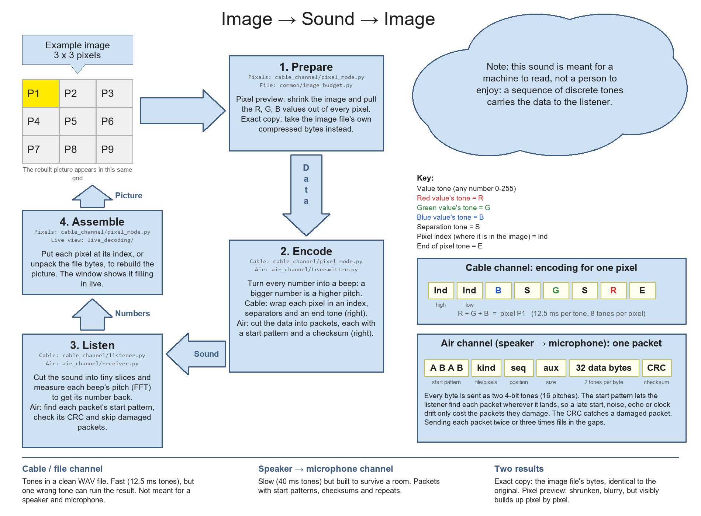

# color-to-sound
This is a side project for the m/cs club. It turns an image into sound and rebuilds the image from
the sound, either from an audio file or live through a microphone.



The diagram above is generated by `python docs/make_diagram.py`; edit that script to change it.

## Run

Requires Python 3.12 or newer.

```bash
pip install -r requirements.txt     # Pillow, numpy and sounddevice (for the microphone)
python main.py
```

The window opens in **normal mode**: choose an image, pick a result (**Exact copy** or **Pixel
preview**) and press **Go**. It makes the sound, listens to it and rebuilds the picture in about
20 seconds, and a four-step tracker with a short plain-language explanation shows what is
happening at each point. Tick *Play the sound while decoding* to watch in real time while hearing
it, or *Send through the air* to play it through the speaker and decode what the microphone hears.
Tick **Advanced** to get every step as its own button (channel, mode, pixel size, repeats, decode
speed, make audio, play, load a WAV, decode, listen).

The three panels are the **Original**, the **Signal** (a live spectrogram of the sound being played
or heard, plus a map of which packets have arrived) and the **Reconstruction**, which fills in as
the sound is decoded and then comes into focus when it is complete. Stop cancels. Play needs
Windows (`winsound`); everything else is cross-platform.

## Channels

| | Cable / file | Speaker -> microphone |
|---|---|---|
| For | a clean WAV file | sound played through a speaker and recorded by a mic |
| Speed | fast (12.5 ms tones) | slow (40 ms tones, 4 bits each) |
| Errors | one bad tone ruins the image (exact copy) or one pixel (pixel preview) | each packet has its own start pattern and CRC, so only damaged packets are lost |
| Lake example | 105 s (exact copy) | about 5 min for a 3 KB version, 1 min for 16x16 pixels |

**Speaker -> microphone**: the sender splits the data into packets of 32 bytes. Each packet is a
start pattern, then `kind | sequence number | aux | data | CRC16` as 4-bit tones (16 tones at
1000-2500 Hz; 600 and 800 Hz are only used for the start pattern). The receiver finds every packet
by its start pattern, so it copes with a recording that starts late, quiet volume, noise, echo,
and sound card clock drift. Lost packets leave a dark gap (pixel preview) or break the file (exact
copy), so use **Repeats** to send each packet more than once. Packets carry their own kind and
size, so the receiver doesn't need to be told the mode.

To try it on one computer: press **Listen (mic)**, then play the audio near the microphone (Play,
or another device). It stops by itself when every packet has arrived, and saves
`output/recorded.wav`. If the level stays near -97 dB, check Windows microphone privacy settings
and the selected input device.

## Modes

- **Exact copy** (`Mode.FILE`): sends the image file itself (already compressed), one tone per
  byte on the cable channel. The result is identical to the original. Over the air the file must
  fit a budget (`AIR_MAX_BYTES` in `air_channel/sender.py`, 3000 bytes), so bigger images are
  re-compressed first. While it arrives the Reconstruction panel shows the bytes as a colored grid;
  the picture appears once everything has arrived, because a half-received compressed file can't be
  shown.
- **Pixel preview** (`Mode.PIXELS`): shrinks the image and sends each pixel's color. It's lossy and
  blurry, but the picture visibly builds up pixel by pixel. Pixel size is the longest side.

## Command line (cable channel)

Run these from the project root.

```bash
python -m cable_channel.file_mode send        # image file -> output/image.wav (length + bytes + CRC32)
python -m cable_channel.file_mode receive     # output/image.wav -> output/received.png

python -m cable_channel.pixel_mode extract    # image -> output/values.txt ("width height", then "r g b" per pixel)
python -m cable_channel.pixel_mode encode     # output/values.txt -> output/out.wav
python -m cable_channel.pixel_mode assemble   # output/out.wav -> output/out.png
```

Add `--help` to any of them for options such as `--image` and `--size`.

## Project layout

```
main.py                 starts the window
common/                 shared by everything
    modes.py            the Channel and Mode enums
    tones.py            turning pitches into audio and writing wav files
    wav_files.py        reading wav files as arrays of samples
    spectrogram.py      drawing a spectrogram of some audio
    pacing.py           slowing a stream down to a chosen speed
    raster.py           a picture as plain numbers, and the values.txt format
    image_budget.py     shrinking an image file to fit an audio budget
    paths.py            where the project's folders are
cable_channel/          the fast channel (clean audio files)
    settings.py         pitches and tone length
    listener.py         turning tones back into numbers
    byte_stream.py      a stream of bytes as tones, with a length and a checksum
    file_mode.py        exact-copy mode (and its command line)
    pixel_mode.py       pixel preview mode (and its command line)
air_channel/            the robust channel (speaker to microphone)
    packets.py          packet format and tone settings
    transmitter.py      payload -> audio
    sender.py           image -> payload -> audio
    receiver.py         finds and decodes packets in recorded audio
    microphone.py       recording from the microphone
live_decoding/          decoding that reports progress, for the live pictures
    events.py           the update type and the small pictures (byte grid, packet map)
    cable.py            live decoding of cable recordings
    air.py              live decoding of air audio (file or microphone)
ui/                     the window
    main_window.py      the window and its behaviour
    decode_session.py   a decode on a background thread, and its queue of updates
    stage_tracker.py    the four-step progress display
    previews.py         preparing pictures, and the finishing animation
    text.py             every explanation and caption
img/                    source images
output/                 generated files (git-ignored, created when needed)
```

## Cable channel in detail

Pixel preview sends each pixel as 8 tones: `(Ind high, Ind low, B, S, G, S, R, E)`. A tone's pitch is
`400 + 80 * value` Hz, `S` (separator) is 160 Hz and `E` (end) is 240 Hz. The audio starts with a
header frame `(width high, width low, S, height high, height low, E)`. The index uses two tones, so
images can have up to 65,536 pixels. Settings are in `cable_channel/settings.py`.

Each tone lasts 12.5 ms. Tone spacing is `1 / TONE_SECONDS` Hz, so shorter tones need wider spacing, and
the highest tone has to stay below half the sample rate. That is fine for a file but too tight for
a speaker and microphone, which is what the air channel is for.

Audio length is `pixels * 8 * 0.0125` seconds on this channel: 64x43 is about 4.6 minutes. The
rebuilt picture is enlarged smoothly to about 800 px (`VIEW_SIZE` in `cable_channel/pixel_mode.py`).

## Code style

```bash
python -m ruff check .     # lint (settings are in pyproject.toml)
```

Code follows PEP 8 and PEP 257: snake_case modules, type hints and a docstring on every public
function, class and module, named constants instead of magic numbers, and enums (`Channel`, `Mode`,
`PayloadKind`) instead of loose strings.
